# RingNAppGUI Package

## Overview

RingNAppGUI package for the Ring programming language

RingNAppGUI brings the NAppGUI library (a cross-platform C SDK for desktop applications) to Ring. NAppGUI uses the native controls of the operating system, so the applications look like the other applications of the system, start quickly and are small.

The package has three parts:

1. **C Extension** (`ring/extensions/ringnappgui`): `ringnappgui.cf` is processed by the Ring code generator to produce `ring_nappgui.c`, which wraps the NAppGUI API (more than 1700 functions and about 390 constants), with helper functions for events, timers, drawing, file dialogs and images.
2. **NAppGUI SDK** (`ring/extensions/libdepwin/nappgui`): the NAppGUI source code, headers and static libraries (Windows x64) used to build the extension, so the extension can be built after installing the package.
3. **Ring Library** (`ring/libraries/nappguilib`): classes for the windows and the controls (`NWindow`, `NLayout`, `NButton`, `NTableView`, `NView`, `NCanvas`, ...) and the `napp*()` functions (application, timers, dialogs and colors).

## Features

- Windows: resizable windows, modal windows, menu bars, keyboard shortcuts, close events
- Layouts: grids of cells with margins, alignment, expanding columns and rows, nested layouts
- Panels with many pages, scroll panels and split views (with a divider that the user can move)
- Controls: labels, links, push buttons, check boxes, radio buttons, flat buttons, text boxes (password, placeholder, filters), combo boxes, popup lists, list boxes (check boxes, colors, multiple selection), sliders, progress bars, up/down buttons and image views
- Text views: text with many fonts, sizes, styles, colors and paragraph alignment
- Tables: columns, alignment, sorting, multiple selection, and fast drawing of large data (only the visible cells are drawn)
- Custom views: draw lines, shapes, gradients, text and images, and get the mouse, wheel and keyboard events
- Off-screen drawing: draw an image in memory and save it as PNG, JPG, BMP or GIF
- Images: load, save, scale, trim and show images
- Fonts: system, monospace and installed fonts, with styles
- Menus: menu bars, sub menus, check items, shortcuts and popup menus
- Dialogs: message, confirm, input, open file, save file and color selection
- Timers and a main loop for animations and games
- Colors: RGB, RGBA, HSB, HTML and named colors
- The library destroys the windows, the menus, the fonts and the images when the application ends
- Rows, columns and indexes start from 1 (like Ring lists)
- Direct access to the NAppGUI functions and constants
- 26 samples, including a calculator, a paint program, a to-do list, charts and the Snake game

## Installation

	ringpm install ringnappgui from ringpackages

The extension (`ring_nappgui.dll`) is built for Windows (64-bit). To build it again (needs Visual C/C++):

	cd ring/extensions/ringnappgui
	gencode.bat
	buildvc_x64.bat

## Screen Shots

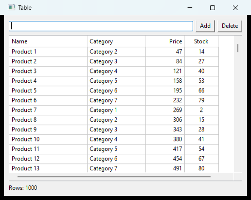

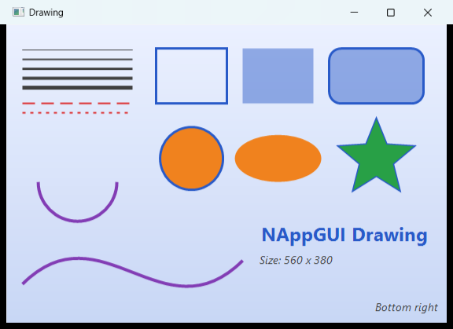

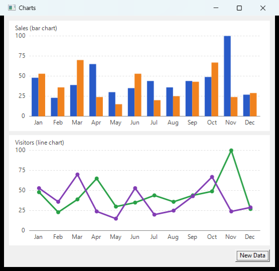

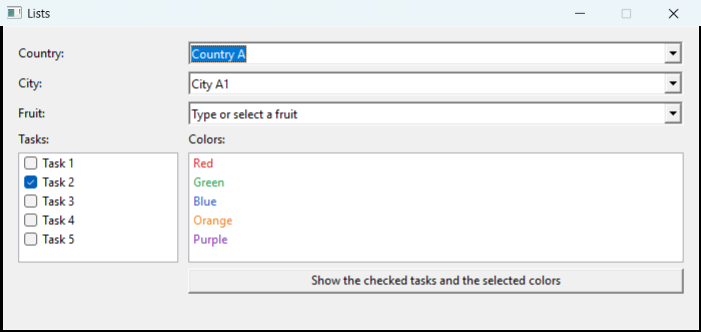

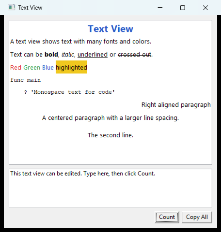

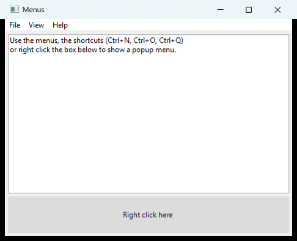

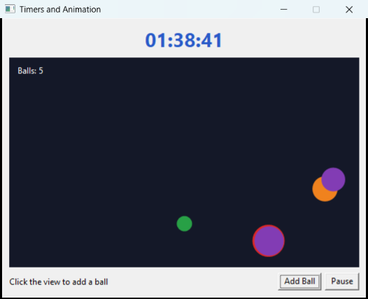

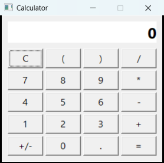

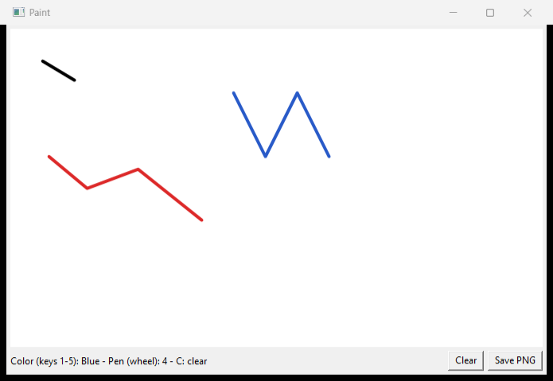

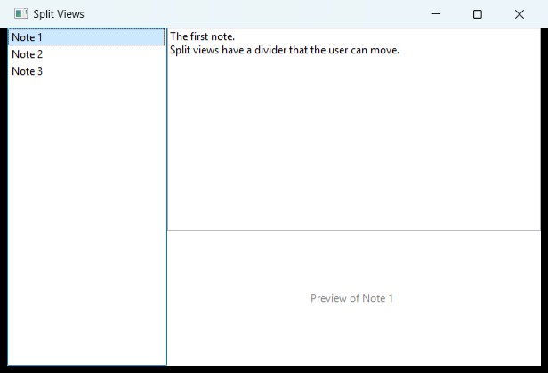

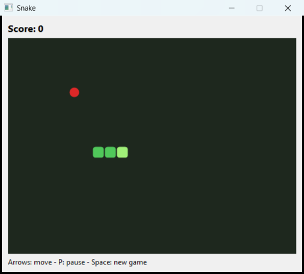

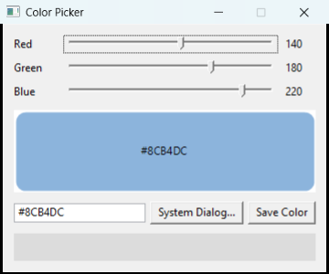

## Quick Start

```ring
load "nappguilib.ring"

oAppText = NULL
nAppClicks = 0

func main
	nappRun("createGUI()")

func createGUI
	oButton = new NButton("Click Me!") { setClickEvent("buttonClick()") }
	oAppText = new NTextView { setSize(250, 100) }

	oLayout = new NLayout(1, 3) {
		add(new NLabel("Hello!, I'm a label"), 1, 1)
		add(oButton, 1, 2)
		add(oAppText, 1, 3)
		setMargin(5)
		setRowsMargin(5)
	}

	new NWindow("Hello, World!") {
		setLayout(oLayout)
		show()
	}

func buttonClick
	nAppClicks++
	oAppText.writeLine("Button click (" + nAppClicks + ")")
```

### How It Works

1. `nappRun("createGUI()")` starts NAppGUI. It runs `createGUI()` and then waits for the events. It returns when the application ends.
2. The controls are put in the cells of an `NLayout` (columns and rows start from 1). A layout can contain other layouts.
3. The window shows the layout. Closing the first window (the main window) ends the application.
4. The events (like `setClickEvent()`) take Ring code as a string. The code runs in the global scope, so the controls that the events use are global variables (like `oAppText`).
5. Inside an event, `nappEvent()` returns an `NEvent` object with the parameters of the event (the mouse position, the key, the selected item, ...).

### Drawing

```ring
load "nappguilib.ring"

func main
	nappRun("createGUI()")

func createGUI
	oView = new NView { setSize(300, 200) setDrawEvent("draw()") }
	oLayout = new NLayout(1, 1) { add(oView, 1, 1) }
	new NWindow("Drawing") { setLayout(oLayout) show() }

func draw
	oCanvas = nappCanvas()
	oCanvas.clear(NAPP_COLOR_WHITE)
	oCanvas.fillCircle(150, 100, 60, NAPP_COLOR_ORANGE)
	oCanvas.setTextAlign(ekCENTER, ekCENTER)
	oCanvas.text("Hello", 150, 100)
```

### Tables

```ring
oTable = new NTableView {
	addColumn("Name", 150)
	addColumn("Price", 80)
	setColumnAlign(2, ekRIGHT)
	setData([["Item 1", 10], ["Item 2", 25], ["Item 3", 15]])
	setHeaderClickEvent("oAppTable.sortByColumn(nappEvent().index(), True)")
}
```

### Timers and Animation

```ring
func main
	nappRunTimer("createGUI()", 0.02)      # The main loop runs each 0.02 seconds

func createGUI
	...
	nappAddTimer(1, "updateClock()")         # Each second
	nappSetUpdateEvent("moveObjects()")      # Each frame
```

---

## API Reference

The NAppGUILib classes use rows, columns and indexes that start from 1. Most methods that change a control return the object, so the calls can be chained or used inside braces: `new NButton("OK") { setTooltip("Save") setClickEvent("save()") }`.

The event methods (`set*Event()`) take Ring code as a string (at most 255 characters), like `"save()"` or `"oAppList.clear()"`.

### Application Functions

| Function | Description |
|----------|-------------|
| `nappRun(cCreateCode)` | Start the application: run `cCreateCode`, then wait for the events |
| `nappRunTimer(cCreateCode, nInterval)` | Start the application with a main loop that runs each `nInterval` seconds (for timers and animation) |
| `nappQuit()` | End the application |
| `nappAddTimer(nSeconds, cCode)` | Run `cCode` each `nSeconds` (with `nappRunTimer()`); returns the timer ID |
| `nappRemoveTimer(nTimerID)` | Stop a timer |
| `nappSetUpdateEvent(cCode)` | Run `cCode` at each frame of the main loop (`""` to stop) |
| `nappTime()` | Seconds since the main loop started |
| `nappEvent()` | The current event as an `NEvent` object |
| `nappCanvas()` | An `NCanvas` object for the draw event of an `NView` |
| `nappVersion()` | The version of NAppGUILib |

### Dialog Functions

`oParent` is an `NWindow` object or `NULL`.

| Function | Description |
|----------|-------------|
| `nappMessage(oParent, cTitle, cText)` | Show a message and wait for the OK button |
| `nappConfirm(oParent, cTitle, cText)` | Ask a question: `True` for Yes, `False` for No |
| `nappInput(oParent, cTitle, cPrompt, cDefault)` | Ask for a text: returns the text, or `NULL` when the user cancels |
| `nappDialog(oParent, cTitle, cText, aButtons, lInput, cDefault)` | A dialog with any buttons: returns the index of the button (or the text when `lInput` is `True`) |
| `nappModalStop(nValue)` | Close the active modal window (`NWindow.modal()` returns `nValue`) |
| `nappOpenFile(oParent, aTypes)` | The open file dialog (`aTypes` like `["png", "jpg"]`): the file name or `""` |
| `nappSaveFile(oParent, aTypes)` | The save file dialog |
| `nappChooseColor(oParent, cTitle, nColor, cCode)` | The color dialog: `cCode` runs when the color changes (read `nappEvent().color()`) |
| `nappOpenURL(cURL)` | Open a web page in the browser |

### Color Functions

Colors are numbers. The `NAPP_COLOR_*` constants are `BLACK`, `WHITE`, `RED`, `GREEN`, `BLUE`, `YELLOW`, `ORANGE`, `PURPLE`, `CYAN`, `GRAY`, `LIGHTGRAY`, `DARKGRAY` and `TRANSPARENT`.

| Function | Description |
|----------|-------------|
| `nappColor(nRed, nGreen, nBlue)` | A color from 0-255 values |
| `nappColorAlpha(nRed, nGreen, nBlue, nAlpha)` | A color with transparency |
| `nappColorHex(cHex)` | A color from `"#RRGGBB"` |
| `nappColorHSB(nHue, nSaturation, nBrightness)` | A color from values between 0 and 1 |
| `nappColorToHex(nColor)` | `"#RRGGBB"` |
| `nappColorParts(nColor)` | `[nRed, nGreen, nBlue, nAlpha]` |

### System Functions

| Function | Description |
|----------|-------------|
| `nappScreenSize()` | `[nWidth, nHeight]` of the screen |
| `nappMousePosition()` | `[nX, nY]` of the mouse on the screen |
| `nappDarkMode()` | True if the system uses the dark mode |
| `nappFontFamilies()` | The installed font families |
| `nappSystemFontFamily()`, `nappMonospaceFontFamily()` | The families of the system fonts |
| `nappPlatform()` | `ekWINDOWS`, `ekMACOS` or `ekLINUX` |

### NWindow

`new NWindow(cTitle)`. The window is created when it's used, so `setFlags()` and `setResizable()` must be called first.

| Method | Description |
|--------|-------------|
| `setFlags(nFlags)` | `ekWINDOW_STD` (default), `ekWINDOW_STDRES` or a combination of `ekWINDOW_TITLE`, `ekWINDOW_MAX`, `ekWINDOW_MIN`, `ekWINDOW_CLOSE`, `ekWINDOW_RESIZE`, `ekWINDOW_RETURN`, `ekWINDOW_ESC` |
| `setResizable(lResizable)` | `ekWINDOW_STDRES` or `ekWINDOW_STD` |
| `setTitle(cTitle)`, `title()` | The title |
| `setLayout(oLayout)` | Show a layout (inside a new panel) |
| `setPanel(oPanel)` | Show a panel |
| `show()`, `hide()` | Show or hide the window |
| `close()` | Destroy the window |
| `modal(oParent)` | Show the window as a modal window; returns the value given to `nappModalStop()` |
| `setOrigin(nX, nY)`, `origin()` | The position on the screen |
| `setSize(nWidth, nHeight)`, `size()`, `clientSize()` | The size |
| `center()` | Put the window in the center of the screen |
| `update()` | Compute the layout again |
| `setDefaultButton(oButton)` | The button pressed by Enter |
| `setFocus(oControl)` | Give the keyboard focus to a control |
| `setMenuBar(oMenu)` | The menu bar |
| `setCursor(nCursor)` | `ekGUI_CURSOR_ARROW`, `ekGUI_CURSOR_HAND`, `ekGUI_CURSOR_IBEAM`, `ekGUI_CURSOR_CROSS`, ... |
| `addHotKey(nKey, nModifiers, cCode)`, `clearHotKeys()` | Keyboard shortcuts (`ekKEY_*` and `ekMKEY_NONE`, `ekMKEY_SHIFT`, `ekMKEY_CONTROL`, `ekMKEY_ALT`) |
| `setCloseEvent(cCode)` | Runs instead of the default action (use `nappEvent().setResult(False)` to keep the window open) |
| `setResizeEvent(cCode)`, `setMovedEvent(cCode)` | Size and position events |
| `isMainWindow()` | True for the first window |

### NLayout

`new NLayout(nColumns, nRows)`.

| Method | Description |
|--------|-------------|
| `add(oControl, nCol, nRow)` | Put a control, a panel or another layout in a cell |
| `columns()`, `rows()` | The size of the grid |
| `insertColumn(nCol)`, `insertRow(nRow)`, `removeColumn(nCol)`, `removeRow(nRow)` | Change the grid |
| `setMargin(nMargin)`, `setMargin4(nTop, nRight, nBottom, nLeft)` | The space around the grid |
| `setColumnMargin(nCol, nMargin)`, `setRowMargin(nRow, nMargin)` | The space after a column or a row |
| `setColumnsMargin(nMargin)`, `setRowsMargin(nMargin)` | The space between all the columns or rows |
| `setColumnWidth(nCol, nWidth)`, `setRowHeight(nRow, nHeight)` | A fixed size |
| `expandColumn(nCol)`, `expandRow(nRow)` | The column or row that takes the extra space when the window is resized |
| `setHAlignCell(nCol, nRow, nAlign)` | `ekLEFT`, `ekCENTER`, `ekRIGHT` or `ekJUSTIFY` (fill the cell) |
| `setVAlignCell(nCol, nRow, nAlign)` | `ekTOP`, `ekCENTER`, `ekBOTTOM` or `ekJUSTIFY` |
| `showColumn(nCol, lVisible)`, `showRow(nRow, lVisible)` | Hide or show (then call `update()`) |
| `setCellEnabled(nCol, nRow, lEnabled)`, `setTabStop(nCol, nRow, lTabStop)` | Cell options |
| `setBackColor(nColor)`, `setBorderColor(nColor)` | Colors |
| `update()` | Compute the layout again |

### NPanel and NScrollPanel

`new NPanel` holds one or more layouts and shows one of them (pages). `new NScrollPanel` has scroll bars.

| Method | Description |
|--------|-------------|
| `setLayout(oLayout)`, `addLayout(oLayout)` | Add a layout; `addLayout()` returns its index |
| `showLayout(nIndex)` | Show a page |
| `layoutCount()` | The number of layouts |
| `setSize(nWidth, nHeight)` | The size of the panel (use it for panels with many layouts) |
| `update()` | Compute the layout again |
| `scrollWidth()`, `scrollHeight()` | The size of the scroll bars (`NScrollPanel`) |

### NSplitView

`new NSplitView(ekGUI_HORIZONTAL)` puts two parts side by side, `new NSplitView(ekGUI_VERTICAL)` puts one part above the other.

| Method | Description |
|--------|-------------|
| `add(oControl)` | Add the first part, then the second part (any control, panel, layout or split view) |
| `setPosition(nPosition)` | The size of the first part (0 to 1) |
| `setSize(nWidth, nHeight)` | The size |

### Common Control Methods (NControl)

All the controls have these methods. `setEnabled()`, `setVisible()` and `setPadding()` work after adding the control to a layout.

| Method | Description |
|--------|-------------|
| `handle()` | The NAppGUI pointer of the control (for the extension functions) |
| `setEnabled(lEnabled)`, `setVisible(lVisible)` | Enable or show the control |
| `setPadding(nPadding)`, `setPadding4(nTop, nRight, nBottom, nLeft)` | The space inside the cell |
| `setTag(nTag)`, `tag()` | A number stored in the control |

### NLabel

`new NLabel(cText)`. A text with new lines (`nl`) creates a multi-line label.

| Method | Description |
|--------|-------------|
| `setText(cText)`, `text()` | The text |
| `setSizeText(cText)` | Compute the size using this text (for labels that change) |
| `setFont(oFont)`, `setAlign(nAlign)` | Font and alignment |
| `setColor(nColor)`, `setBackColor(nColor)` | Colors |
| `setHoverColor(nColor)`, `setHoverBackColor(nColor)`, `setHoverStyle(nStyle)` | Colors and style under the mouse (links) |
| `setClickEvent(cCode)` | Click event |

### NButton, NCheckBox, NRadioButton and NFlatButton

`new NButton(cText)`, `new NCheckBox(cText)`, `new NRadioButton(cText)` and `new NFlatButton(cText)`. The radio buttons of the same layout make one group.

| Method | Description |
|--------|-------------|
| `setText(cText)`, `text()`, `setAltText(cText)` | The text |
| `setTooltip(cText)`, `setFont(oFont)` | Tooltip and font |
| `setImage(oImage)`, `setAltImage(oImage)` | Images (flat buttons) |
| `setChecked(lChecked)`, `isChecked()` | Check boxes and radio buttons |
| `setState(nState)`, `state()` | `ekGUI_ON`, `ekGUI_OFF` or `ekGUI_MIXED` |
| `setButtonTag(nTag)`, `buttonTag()`, `setVPadding(nPadding)` | Options |
| `setClickEvent(cCode)` | Click event |

### NEdit

`new NEdit(cText)`: a single line text box.

| Method | Description |
|--------|-------------|
| `setText(cText)`, `text()`, `number()` | The text, or the text as a number |
| `setPlaceholder(cText)` | The text shown when the box is empty |
| `setPassword(lPassword)`, `setEditable(lEditable)`, `setAutoSelect(lAutoSelect)` | Options |
| `setAlign(nAlign)`, `setTooltip(cText)`, `setFont(oFont)` | Look |
| `setColor(nColor)`, `setBackColor(nColor)`, `setFocusBackColor(nColor)` | Colors |
| `selectText(nStart, nEnd)`, `copyText()`, `cutText()`, `pasteText()` | Selection and clipboard (positions from 0, -1 for the end) |
| `setChangeEvent(cCode)` | Runs after the text is changed (Enter or leaving the box) |
| `setFilterEvent(cCode)` | Runs at each key: read `nappEvent().text()`, change it using `nappEvent().setFilterText(cText, nCaretPos)` |
| `setFocusEvent(cCode)` | Focus event |

### NCombo

`new NCombo`: a text box with a list.

| Method | Description |
|--------|-------------|
| `addItem(cText)`, `addItems(aItems)`, `setItem(nIndex, cText)`, `insertItem(nIndex, cText)`, `removeItem(nIndex)` | Items |
| `count()`, `itemText(nIndex)` | Read the items |
| `setText(cText)`, `text()` | The text of the box |
| `setPlaceholder(cText)`, `setTooltip(cText)`, `setColor(nColor)`, `setBackColor(nColor)` | Look |
| `setChangeEvent(cCode)`, `setFilterEvent(cCode)` | Events |

### NPopUp

`new NPopUp`: a drop-down list.

| Method | Description |
|--------|-------------|
| `addItem(cText)`, `addImageItem(cText, oImage)`, `addItems(aItems)`, `setItem(nIndex, cText)`, `clear()` | Items |
| `count()`, `itemText(nIndex)` | Read the items |
| `setSelected(nIndex)`, `selected()`, `selectedText()` | The selected item |
| `setListHeight(nItems)`, `setTooltip(cText)` | Options |
| `setSelectEvent(cCode)` | Selection event (`nappEvent().index()`) |

### NListBox

`new NListBox`.

| Method | Description |
|--------|-------------|
| `addItem(cText)`, `addImageItem(cText, oImage)`, `addItems(aItems)`, `setItem(nIndex, cText)`, `clear()` | Items |
| `count()`, `itemText(nIndex)`, `setItemColor(nIndex, nColor)` | Items |
| `setSelected(nIndex)`, `selected()` | Select one item, or get the first selected item |
| `setMultiSelect(lMultiSelect)`, `setItemSelected(nIndex, lSelected)`, `isSelected(nIndex)`, `selectedItems()` | Multiple selection |
| `setCheckBoxes(lShow)`, `setChecked(nIndex, lChecked)`, `isChecked(nIndex)`, `checkedItems()` | Check boxes |
| `setSize(nWidth, nHeight)` | The size |
| `setSelectEvent(cCode)` | Selection event |

### NSlider, NVerticalSlider, NProgress and NUpDown

| Method | Description |
|--------|-------------|
| `NSlider.setRange(nMin, nMax)` | The range of the values (0 to 1 by default) |
| `NSlider.setValue(nValue)`, `NSlider.value()` | The value inside the range |
| `NSlider.setSteps(nSteps)`, `NSlider.setTooltip(cText)` | Options |
| `NSlider.setMoveEvent(cCode)` | Runs when the slider moves |
| `NProgress.setValue(nValue)` | A value from 0 to 1 |
| `NProgress.setUndefined(lRunning)` | An animated bar |
| `NUpDown.setClickEvent(cCode)` | Use `nappEvent().isUp()` |
| `NUpDown.setTooltip(cText)` | Tooltip |

### NTextView

`new NTextView`: text with fonts, colors and paragraph styles. The style methods change the text that is written after them.

| Method | Description |
|--------|-------------|
| `write(cText)`, `writeLine(cText)` | Add text at the end |
| `setText(cText)`, `text()`, `clear()` | The text |
| `setFontFamily(cFamily)`, `setFontSize(nSize)`, `setFontStyle(nStyle)` | The font (`"monospace"` for the monospace family) |
| `setColor(nColor)`, `setBackColor(nColor)`, `setPageColor(nColor)` | Colors |
| `setAlign(nAlign)`, `setLineSpacing(nScale)`, `setParagraphSpace(nBefore, nAfter)` | Paragraphs |
| `setEditable(lEditable)`, `setSize(nWidth, nHeight)`, `setScrollVisible(lH, lV)`, `scrollToCaret()` | Options |
| `selectText(nStart, nEnd)`, `copyText()`, `cutText()`, `pasteText()` | Selection and clipboard |
| `setFilterEvent(cCode)`, `setFocusEvent(cCode)` | Events |

### NTableView

`new NTableView`. The data is a list of rows, and each row is a list of values (strings or numbers). Only the visible cells are drawn, so tables with many rows are fast.

| Method | Description |
|--------|-------------|
| `addColumn(cTitle, nWidth)` | Add a column; returns its number |
| `columnCount()`, `setColumnTitle(nCol, cTitle)`, `setColumnWidth(nCol, nWidth)`, `setColumnLimits(nCol, nMin, nMax)` | Columns |
| `setColumnAlign(nCol, nAlign)` | The alignment of the cells and the title |
| `freezeColumns(nCol)` | The first columns don't scroll horizontally |
| `setData(aRows)`, `data()`, `clear()` | All the rows |
| `addRow(aRow)`, `setRow(nRow, aRow)`, `row(nRow)`, `removeRow(nRow)`, `rowCount()` | One row |
| `sortByColumn(nCol, lAscending)` | Sort the rows and show the arrow in the title |
| `selected()`, `selectedRow()`, `selectRows(aRows)`, `deselectAll()` | Selection |
| `focusRow(nRow)`, `focusedRow()` | Scroll to a row |
| `setMultiSelect(l)`, `setGrid(lHorizontal, lVertical)`, `setHeaderVisible(l)`, `setHeaderClickable(l)`, `setRowHeight(n)`, `setFont(oFont)`, `setSize(w, h)` | Options |
| `update()` | Draw the table again |
| `setSelectEvent(cCode)` | Selection event (`nappEvent().rows()`) |
| `setRowClickEvent(cCode)` | Row click (`nappEvent().row()`) |
| `setHeaderClickEvent(cCode)` | Title click (`nappEvent().index()` is the column) |

### NView and NScrollView

`new NView`: a view for drawing. `new NScrollView` has scroll bars (use `setContentSize()`).

| Method | Description |
|--------|-------------|
| `setSize(nWidth, nHeight)`, `size()` | The size |
| `update()` | Draw again |
| `setContentSize(nWidth, nHeight, nLineWidth, nLineHeight)`, `viewport()`, `scrollTo(nX, nY)` | Scrolling |
| `setDrawEvent(cCode)`, `setOverlayEvent(cCode)` | Drawing (use `nappCanvas()`) |
| `setClickEvent()`, `setMouseDownEvent()`, `setMouseUpEvent()`, `setMouseMoveEvent()`, `setDragEvent()`, `setEnterEvent()`, `setExitEvent()`, `setWheelEvent()` | Mouse events |
| `setKeyDownEvent()`, `setKeyUpEvent()`, `setFocusEvent()` | Keyboard events (the view gets the focus when clicked, or using `NWindow.setFocus()`) |
| `setResizeEvent()`, `setScrollEvent()` | Size and scroll events |

### NCanvas

Get it using `nappCanvas()` inside the draw event, or draw an image using `createBitmap()` and `toImage()`. `nOp` is `ekSTROKE`, `ekFILL`, `ekSKFILL` or `ekFILLSK`. Points are lists of `[nX, nY]`.

| Method | Description |
|--------|-------------|
| `width()`, `height()` | The size of the area |
| `createBitmap(nWidth, nHeight)`, `toImage()` | Off-screen drawing |
| `clear(nColor)`, `setAntialias(lAntialias)` | Background |
| `setLineColor(nColor)`, `setLineWidth(nWidth)`, `setLineCap(nCap)`, `setLineJoin(nJoin)`, `setLineDash(aPattern)` | Lines |
| `line(x1, y1, x2, y2)`, `polyline(lClosed, aPoints)`, `arc(x, y, r, nStart, nSweep)`, `bezier(x1, y1, cx1, cy1, cx2, cy2, x2, y2)` | Lines and curves |
| `setFillColor(nColor)`, `setGradient(aColors, aStops, x1, y1, x2, y2)` | Fill |
| `rect(nOp, x, y, w, h)`, `fillRect(x, y, w, h, nColor)`, `roundRect(nOp, x, y, w, h, r)` | Rectangles |
| `circle(nOp, x, y, r)`, `fillCircle(x, y, r, nColor)`, `ellipse(nOp, x, y, rx, ry)`, `polygon(nOp, aPoints)` | Shapes |
| `setFont(oFont)`, `setTextColor(nColor)`, `setTextAlign(nHAlign, nVAlign)`, `setTextWidth(nWidth)`, `setTextTrim(nEllipsis)` | Text style |
| `text(cText, x, y)`, `textSize(cText)` | Text |
| `image(oImage, x, y)`, `setImageAlign(nHAlign, nVAlign)` | Images |

### NImage and NImageView

`new NImage(cFileName)` loads an image (PNG, JPG, BMP or GIF). `new NImageView` shows an image.

| Method | Description |
|--------|-------------|
| `NImage.loadFile(cFileName)` | Returns True if the file is loaded |
| `NImage.save(cFileName)`, `NImage.setCodec(nCodec)` | Save (`ekPNG`, `ekJPG`, `ekBMP`, `ekGIF`) |
| `NImage.width()`, `NImage.height()`, `NImage.frames()`, `NImage.isEmpty()` | Information |
| `NImage.scaled(nWidth, nHeight)`, `NImage.trimmed(nX, nY, nWidth, nHeight)` | New images |
| `NImage.destroy()` | Free the image now (or it's freed at the end) |
| `NImageView.setImage(oImage)`, `NImageView.setScale(nScale)`, `NImageView.setSize(w, h)` | Show an image (`ekGUI_SCALE_AUTO`, `ekGUI_SCALE_NONE`, `ekGUI_SCALE_ASPECT`, `ekGUI_SCALE_ASPECTDW`) |
| `NImageView.setClickEvent(cCode)` | Click event |

### NFont

`new NFont(cFamily, nSize, nStyle)`: `""` for the system font and `"monospace"` for the monospace font. The style is `ekFNORMAL` or a combination of `ekFBOLD`, `ekFITALIC`, `ekFUNDERLINE` and `ekFSTRIKEOUT`.

| Method | Description |
|--------|-------------|
| `family()`, `size()`, `style()`, `height()` | Information |
| `textSize(cText)` | `[nWidth, nHeight]` of a text |
| `withStyle(nStyle)` | A new font with another style |
| `destroy()` | Free the font now (or it's freed at the end) |

### NMenu and NMenuItem

`new NMenu` and `new NMenuItem(cText)`. A menu bar is a menu whose items have sub menus.

| Method | Description |
|--------|-------------|
| `NMenu.add(oItem)`, `NMenu.addSeparator()`, `NMenu.count()` | Items |
| `NMenu.popup(nX, nY)`, `NMenu.popupAtMouse()` | Show as a popup menu |
| `NMenuItem.setText(cText)`, `NMenuItem.text()` | The text |
| `NMenuItem.setClickEvent(cCode)` | Click event |
| `NMenuItem.setKey(nKey, nModifiers)` | Shortcut, like `setKey(ekKEY_S, ekMKEY_CONTROL)` |
| `NMenuItem.setSubMenu(oMenu)` | A sub menu |
| `NMenuItem.setEnabled(l)`, `NMenuItem.setVisible(l)`, `NMenuItem.setChecked(l)`, `NMenuItem.setImage(oImage)` | Options |

### NEvent

`nappEvent()` returns an `NEvent` object inside an event. Indexes, rows and columns start from 1.

| Method | Description |
|--------|-------------|
| `eventType()` | `ekGUI_EVENT_BUTTON`, `ekGUI_EVENT_DRAW`, `ekGUI_EVENT_CLICK`, ... |
| `params()`, `param(cName)`, `hasParam(cName)` | All the parameters (see the extension README) |
| `x()`, `y()`, `button()`, `clicks()`, `modifiers()`, `wheel()` | Mouse |
| `key()` | Keyboard (`ekKEY_*`) |
| `index()`, `state()`, `isChecked()`, `isUp()`, `text()`, `caretPos()`, `value()`, `color()`, `focus()`, `origin()` | Controls |
| `width()`, `height()`, `canvas()` | Size and drawing |
| `row()`, `column()`, `rows()` | Tables |
| `setResult(lValue)` | For example, `False` inside the close event keeps the window open |
| `setFilterText(cText, nCaretPos)` | Change the text inside a filter event |
| `setWindowSize(nWidth, nHeight)` | Change the size while the window is resized |

---

### Extension Functions

The NAppGUI functions (`window_create()`, `layout_label()`, `draw_line()`, `image_from_pixels()`, ...) and constants (`ekWINDOW_STD`, `ekKEY_A`, `ekFBOLD`, ...) can be used directly, with the classes or without them. The object methods return the NAppGUI pointers using `handle()`. See `ring/extensions/ringnappgui/README.md`.

## Tips

- Write the program inside `func main`, and give the global variables names that start with `oApp`, `nApp`, `cApp`, ... In Ring, a function that assigns to a name that exists as a global variable changes the global variable, so names like `oWindow` or `nCount` could be changed by the library.
- The event code runs in the global scope: the controls used by the events must be global variables.
- Objects are copied when they are assigned (`oA = oB`) or added to lists. A copy of a control object still uses the same control.
- Add the controls to a layout: a control that is not added to a layout (and a window) is not destroyed.
- Create fonts and images once (in `createGUI()`, not in the draw event).
- For a panel with many layouts, use `NPanel.setSize()` instead of the column width or the row height of the cell that holds the panel.
- The windows, the menus, the fonts and the images are destroyed by `nappQuit()` (or when the main window is closed).

## Samples

See the folder `ring/samples/UsingNAppGUI`:

| Sample | Description |
|--------|-------------|
| `test01_hello_extension.ring` | Hello World using the extension functions |
| `test02_hello_library.ring` | Hello World using NAppGUILib |
| `test03_buttons.ring` | Push buttons, check boxes, radio buttons, enabling controls |
| `test04_labels_fonts.ring` | Fonts, colors, multi-line labels and links |
| `test05_edit_boxes.ring` | Placeholder, password, read only, filters and change events |
| `test06_lists.ring` | Popup lists, combo boxes and list boxes |
| `test07_slider_progress.ring` | Sliders, progress bars and up/down buttons |
| `test08_textview.ring` | Text with fonts, styles, colors and alignment |
| `test09_layouts.ring` | Nested layouts, alignment, expanding cells, hiding rows |
| `test10_table.ring` | A table with 1000 rows: sorting, selection, search, add and delete |
| `test11_drawing.ring` | Lines, shapes, gradients, curves and text |
| `test12_paint.ring` | A paint program: mouse, wheel and keyboard events, save as PNG |
| `test13_menus.ring` | Menu bar, sub menus, shortcuts, check items and popup menus |
| `test14_dialogs.ring` | Message, confirm, input, files and colors |
| `test15_timers_animation.ring` | A clock and an animation |
| `test16_images.ring` | Draw an image, save, load, scale and show it |
| `test17_split_views.ring` | Split views inside split views |
| `test18_panels_pages.ring` | A wizard: a panel with pages |
| `test19_calculator.ring` | A calculator with keyboard shortcuts |
| `test20_todo_app.ring` | A to-do list saved in a file |
| `test21_snake_game.ring` | The Snake game |
| `test22_low_level_drawing.ring` | Drawing and mouse events using the extension functions |
| `test23_color_picker.ring` | Sliders, a color preview, HTML colors and the color dialog |
| `test24_charts.ring` | Bar and line charts |
| `test25_scroll_view.ring` | A large drawing with scroll bars, and a scroll panel |
| `test26_unit_tests.ring` | Unit tests (expected result: `Failed: 0`) |

## License

MIT License.
